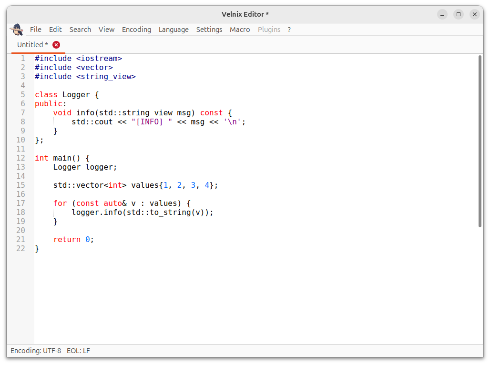
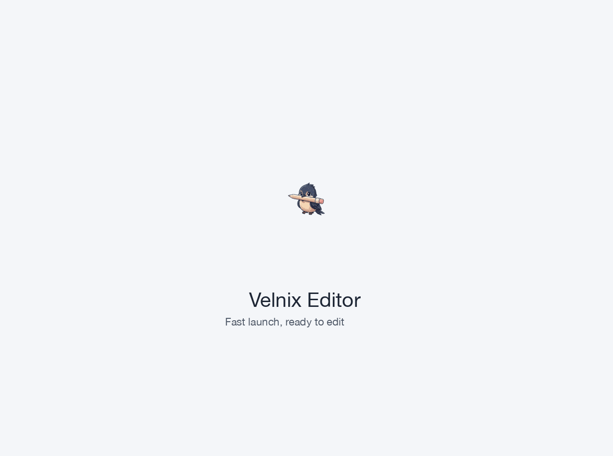
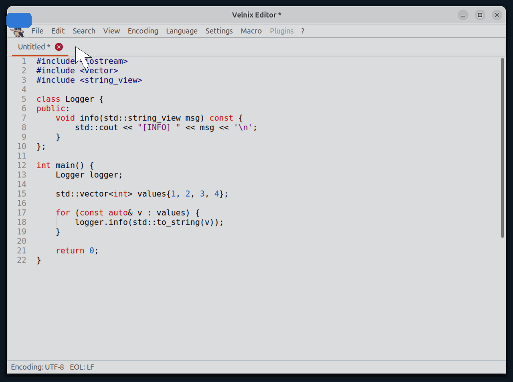
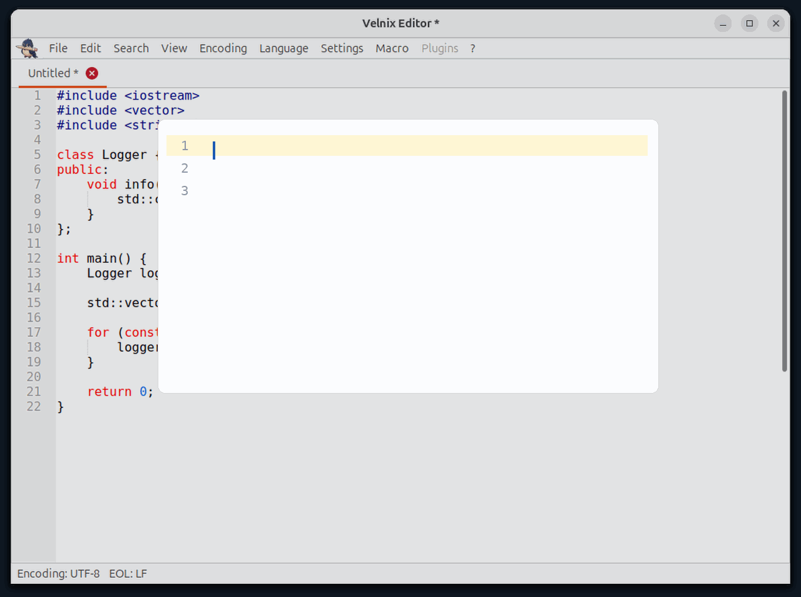
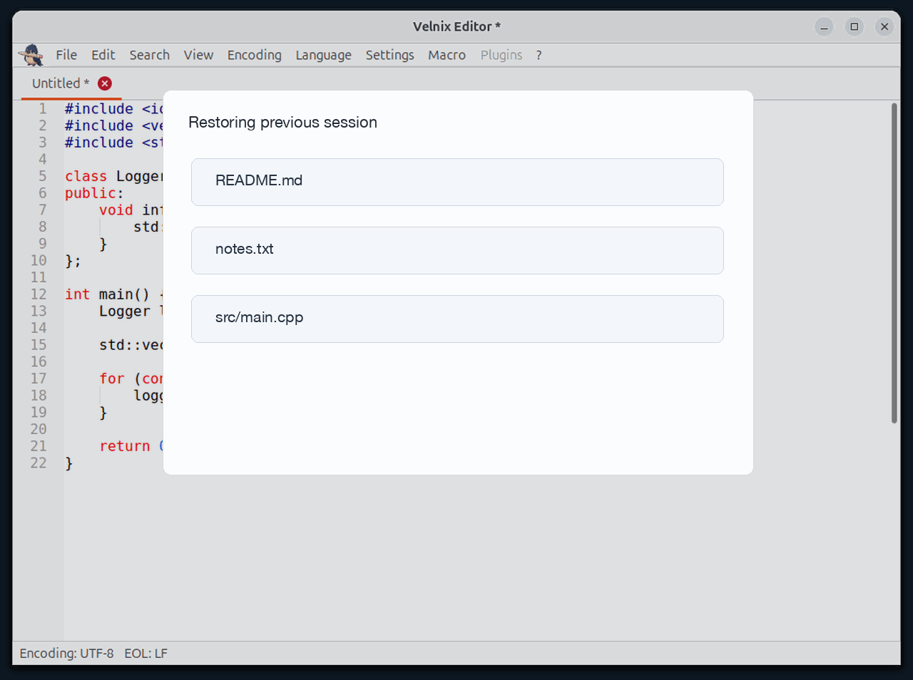
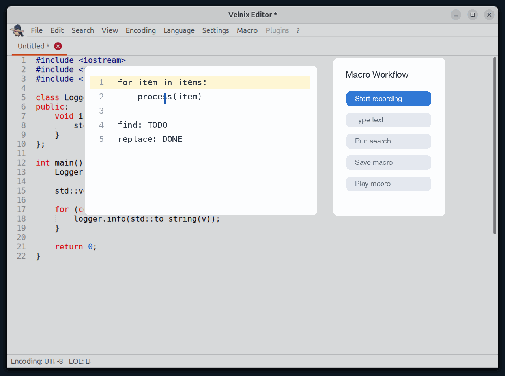
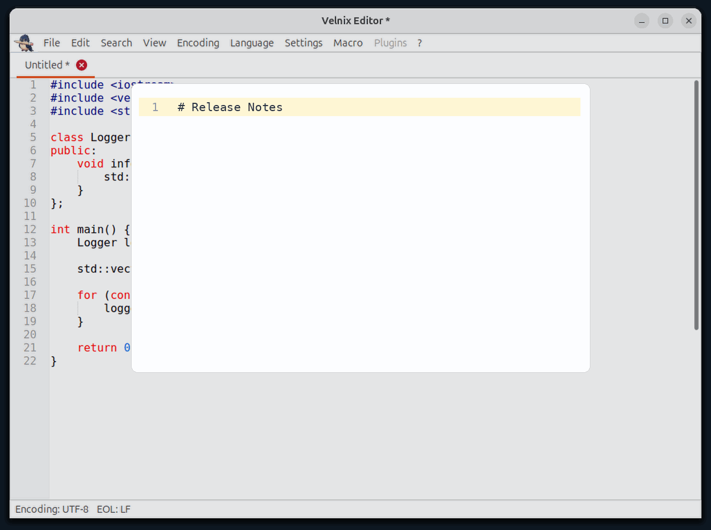

# Velnix Editor

Fast. Native. Practical.

Velnix Editor is a lightweight native text editor for Linux developers. It is made for people who want a quick, flexible, and capable editor for everyday text
and source-code work.

Built with GTK, Scintilla, and Lexilla, Velnix Editor focuses on direct, efficient editing workflows in a clean native desktop application.

Current release target: **0.1.7**.

## Screenshot



## Feature Demos

Current demos focus on implemented editing workflows in the current release.

### Fast Startup



### Opening Files



### Editing Basics



### Session Restore



### Macro Recording and Playback



### Markdown Syntax Highlighting



## Features

- Native GTK interface with fast startup and low overhead
- Multi-tab editing for text and source files, with menu, command-line, and
  drag-and-drop file opening
- Scrollable tab navigation with wheel support, active-tab reveal, and visual
  drag-and-drop reordering feedback
- Non-modal find and replace with backwards search, syntax highlighting,
  per-document custom keyword highlighting, and macro recording/playback
- Current-document match counting with localized feedback in the Find dialog
- Editor context-menu access to common editing, case conversion, whitespace,
  and custom-highlighting actions
- Automatic legacy-encoding detection, manual reopen-with-encoding support,
  and lossless UTF conversion workflows
- Interactive status-bar controls for language, EOL mode, and encoding
- Unicode selection character counts in the status bar
- System font selection with monospaced filtering and live font/size preview
- Automatic and manual update checks, preferences, shortcuts, recent files,
  and external-change prompts

## Philosophy

Velnix Editor is not trying to become a heavy IDE. It is focused on the daily
editing loop: open quickly, edit comfortably, search confidently, save safely,
and stay out of the way.

The early release line starts with a solid native editor foundation. Future
versions can grow into themes, richer file-opening feedback, and plugins, but
the center of the project should remain simple: practical power without
unnecessary weight.

## Why Velnix?

Many Linux text editors are either minimal utilities or full IDEs.
Velnix Editor aims to stay in the middle ground:

- lightweight but capable
- native but modern
- practical without unnecessary complexity

## Try It From Source

```bash
cmake -S . -B build -DCMAKE_BUILD_TYPE=Release
cmake --build build -j4
./build/VelnixEditor/velnix-editor [file ...]
```

The executable is generated under `build/VelnixEditor/`. File arguments are
optional; when provided, they are opened after any restored session tabs.

## Package

Build a local Debian package:

```bash
./scripts/build-deb.sh
```

The generated package is written to `dist/`.

## Release

Pushes to `main` and pull requests are built automatically by GitHub Actions.
To publish a GitHub Release, first make sure the version in `CMakeLists.txt`
and `CHANGELOG.md` is current, then push a matching version tag:

```bash
git tag v0.1.7
git push origin v0.1.7
```

The tag must match the CMake project version. A successful tagged build uses
the matching version section from `CHANGELOG.md` as the release description.
It publishes the `amd64` and `arm64` Debian packages, `SHA256SUMS`, and
`CHANGELOG.md` as GitHub Release assets.

## Runtime Data

User configuration is stored under `~/.config/velnix-editor/` by default.

## Developer Documentation

- [Project Overview](README_PROJECT.md)
- [Installation and Packaging](docs/INSTALL.md)
- [Testing](docs/TESTING.md)
- [Encoding Behavior](docs/ENCODING.md)
- [Known Limitations](docs/KNOWN_ISSUES.md)
- [Third-Party Notices](docs/THIRD_PARTY_NOTICES.md)
- [Release Checklist](docs/RELEASE_CHECKLIST.md)
- [Release Notes 0.1.7](docs/RELEASE_NOTES_0.1.7.md)
- [Release Notes 0.1.6](docs/RELEASE_NOTES_0.1.6.md) - historical release snapshot
- [Release Notes 0.1.5](docs/RELEASE_NOTES_0.1.5.md) - historical release snapshot
- [Release Notes 0.1.4](docs/RELEASE_NOTES_0.1.4.md) - historical release snapshot
- [Release Notes 0.1.3](docs/RELEASE_NOTES_0.1.3.md) - historical release snapshot
- [Release Notes 0.1.2](docs/RELEASE_NOTES_0.1.2.md) - historical release snapshot
- [Release Notes 0.1.1](docs/RELEASE_NOTES_0.1.1.md) - historical release snapshot
- [Release Notes 0.1.0](docs/RELEASE_NOTES_0.1.0.md) - historical release snapshot
- [Roadmap](docs/ROADMAP.md)

## License

Velnix Editor is distributed under the GNU General Public License version 3.
See [LICENSE](LICENSE) and [Third-Party Notices](docs/THIRD_PARTY_NOTICES.md)
for details.

The Velnix Editor name, logo, and application icon are protected project brand
assets. See [TRADEMARKS.md](TRADEMARKS.md) for permitted use.
